

  
  <h1>Edoko</h1>
  
<b>L'écosystème numérique de l'UTC réinventé dans une interface unique, ultra-rapide et moderne.</b>

  

    
    
    
    
  

  

    <a href="https://edoko-utc.vercel.app"><b>🌐 Découvrir le site vitrine & tester la démo interactive →</b></a>
  

  

    
    
    
  

---

Edoko est une extension de navigateur moderne conçue pour les étudiants de l'Université de Technologie de Compiègne (UTC). Elle regroupe tous les outils numériques indispensables à la vie étudiante dans une interface unique, ultra-rapide, et au design soigné.

Finis les dizaines d'onglets ouverts pour consulter son emploi du temps, ses mails ou ses notes : tout est désormais accessible en un clic.

---

## 📸 Aperçu de l'Interface

  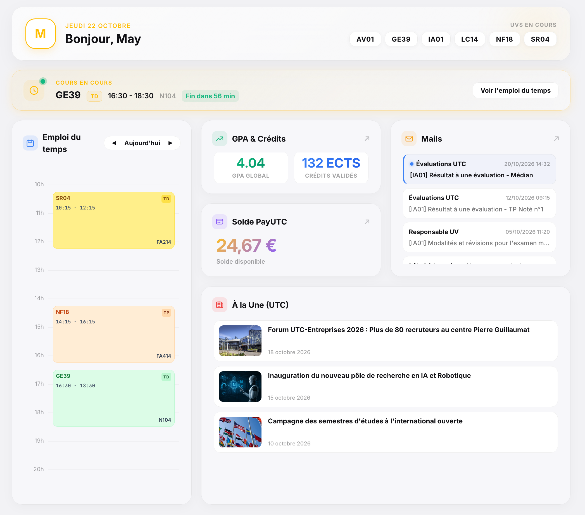
  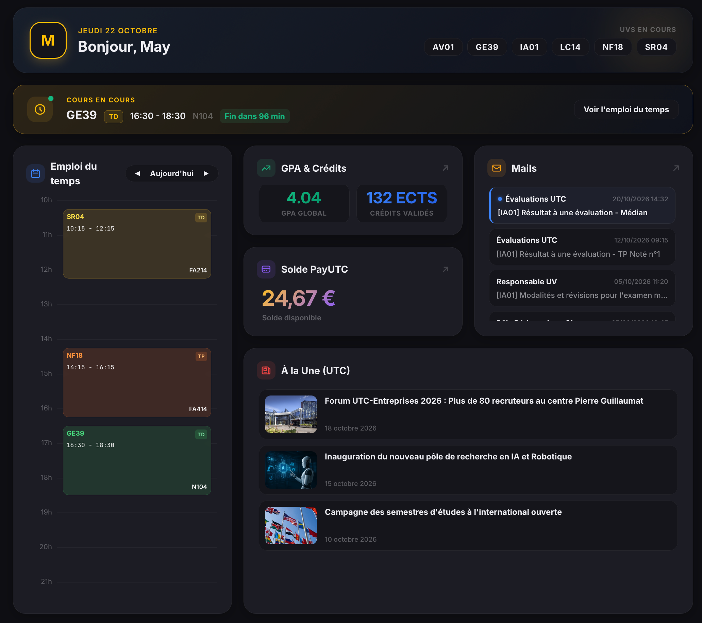
  
<i>Tableau de bord complet en thème clair et thème sombre : prochains cours, mails récents, solde PayUTC et actualités UTC.</i>

---

## ✨ Fonctionnalités Principales

### 📊 1. Tableau de bord intelligent & connecté
Un véritable centre d'accueil pour bien démarrer votre journée :
- **Prochains cours en direct** : affichage immédiat de votre prochaine séance, de la salle et des horaires avec compte à rebours dynamique.
- **Mails récents Webmail** : notification et lecture rapide de vos derniers courriels universitaires.
- **Solde PayUTC en direct** : visualisez votre solde restant et vos dépenses en un clin d'œil.
- **Fil d'actualité UTC** : restez informé des événements, conférences et annonces importantes du campus.
- **Mode Sombre / Mode Clair natif** pour s'adapter à votre préférence visuelle à toute heure.

---

### ⚡ 2. Spotko : La recherche universelle façon Spotlight / Raycast (`⌘K`)
Une palette de commandes ultra-rapide accessible à tout moment via le raccourci **`⌘K`** (Mac) ou **`Ctrl+K`** (Windows) ou simplement la touche **`/`** :
- **Filtres et scopes intelligents** :
  - `mails:INF2` : ouvre instantanément la section mails du Hub UV de l'UV INF2.
  - `mails:travail de groupe` : filtre et recherche en direct parmi tous vos e-mails reçus sur le Webmail UTC.
  - `moodle:SY02` : saute directement dans l'espace Moodle avec les chapitres et devoirs.
  - `annales:SR01` : accès immédiat aux sujets d'examens passés et corrections Shwet.
  - `stats:IA02` : consultation du taux de réussite et des retours d'étudiants.
  - `evals:NF16` : barèmes officiels et suivi des épreuves.
  - `copies:LO21` : téléchargement direct de vos copies corrigées Wexam.
  - `salle:B104` : planning des cours se déroulant dans la salle et statut d'occupation en direct.
  - `payutc:` : affichage de votre solde actuel, historique et virements rapides.
- **Recherche universelle intelligente** : tapez n'importe quelle UV ou terme (ex: `algorithmique`, `planning`, `export`) pour lancer l'action en une touche de clavier.

  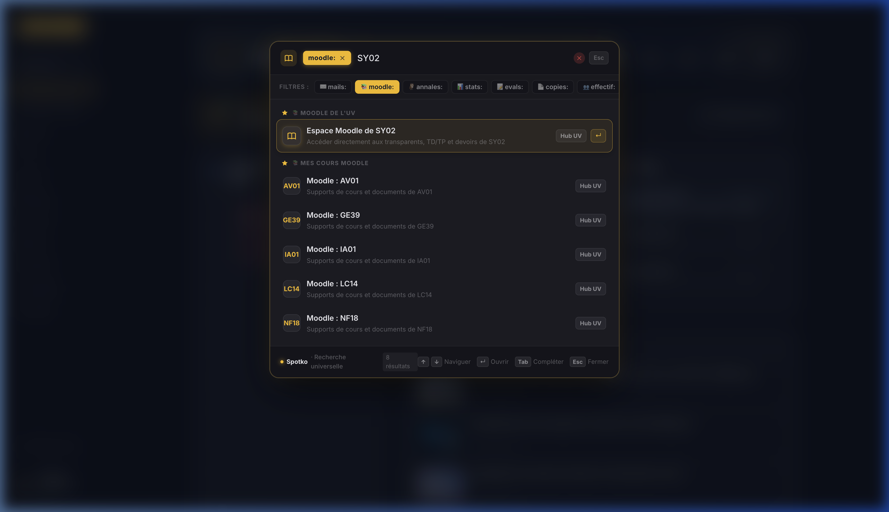

---

### 📅 3. Emploi du temps synchronisé & Export haute fidélité
- **Accès instantané & hors-ligne** : consultez votre planning en temps réel sans rechargement lourd de page.
- **Export en 1 clic** :
  - **Export `.ics`** pour synchroniser directement votre planning avec Google Agenda, Apple Calendar ou Outlook.
  - **Export Image `.png`** propre et prêt à être partagé ou imprimé.

  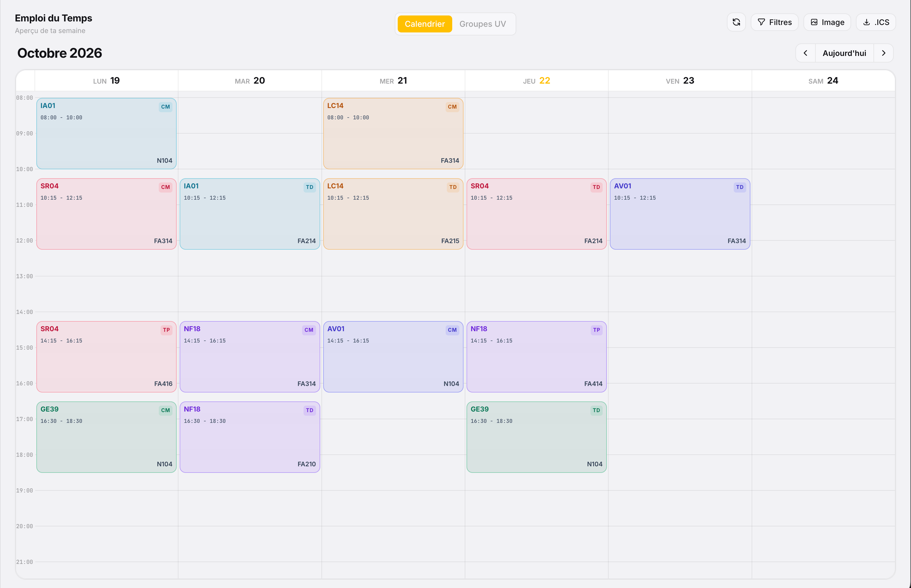
  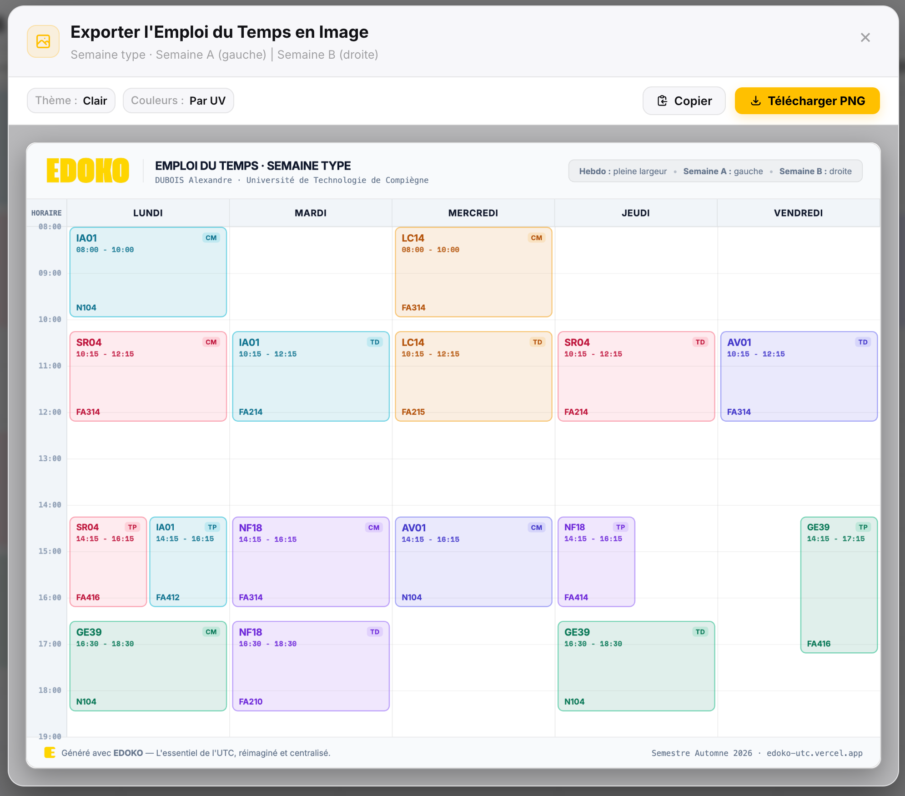

---

### 🎓 4. Cursus, Simulateurs & Calculateur de Notes
Pilotez votre parcours académique avec précision :
- **Suivi de Cursus** : récapitulatif détaillé de vos semestres, crédits validés (CS, TM, TSH) et calcul automatique de votre **GPA**.
- **Simulateur de Cursus & d'Emploi du Temps** : prévoyez vos futurs semestres en ajoutant vos UVs cibles, visualisez l'impact sur vos crédits et vérifiez les chevauchements d'horaires dans l'emploi du temps simulé.
- **Calculateur de Moyenne** : simulez vos notes d'examens (médians, finaux, TPs) pour anticiper vos résultats et sécuriser vos validations.

  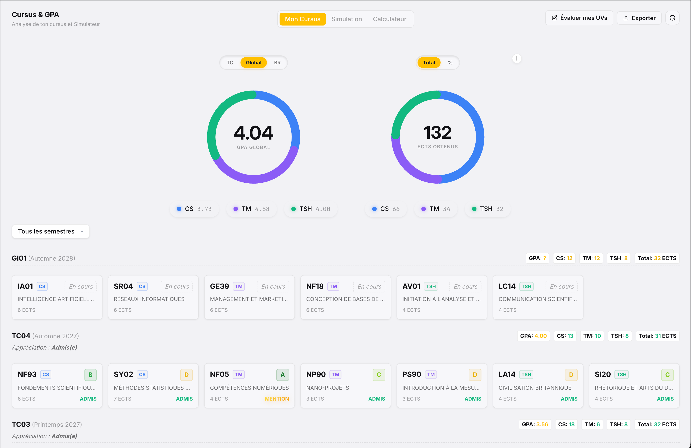
  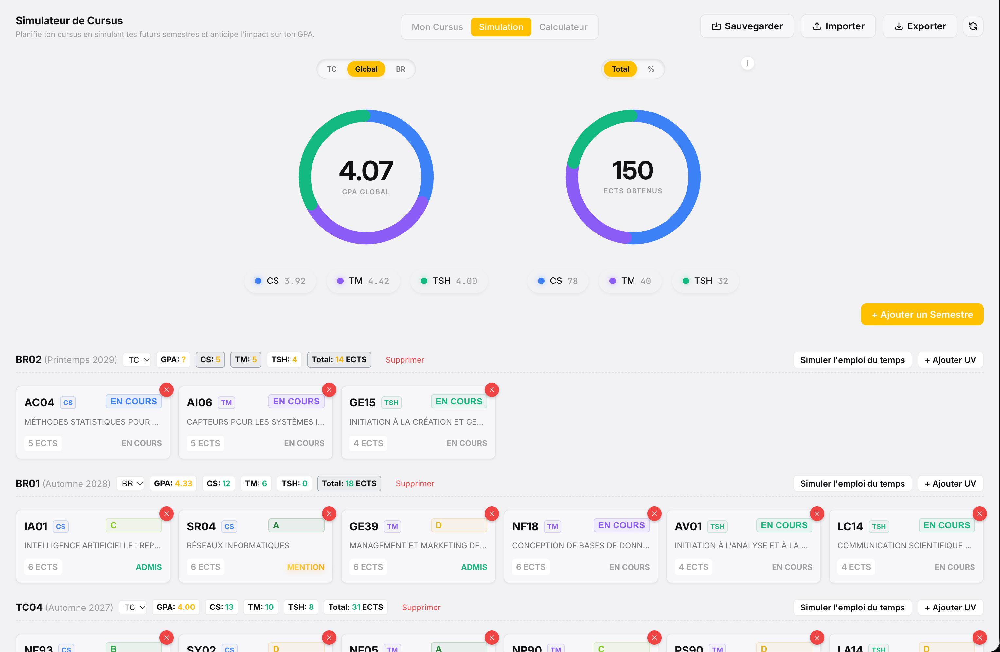
  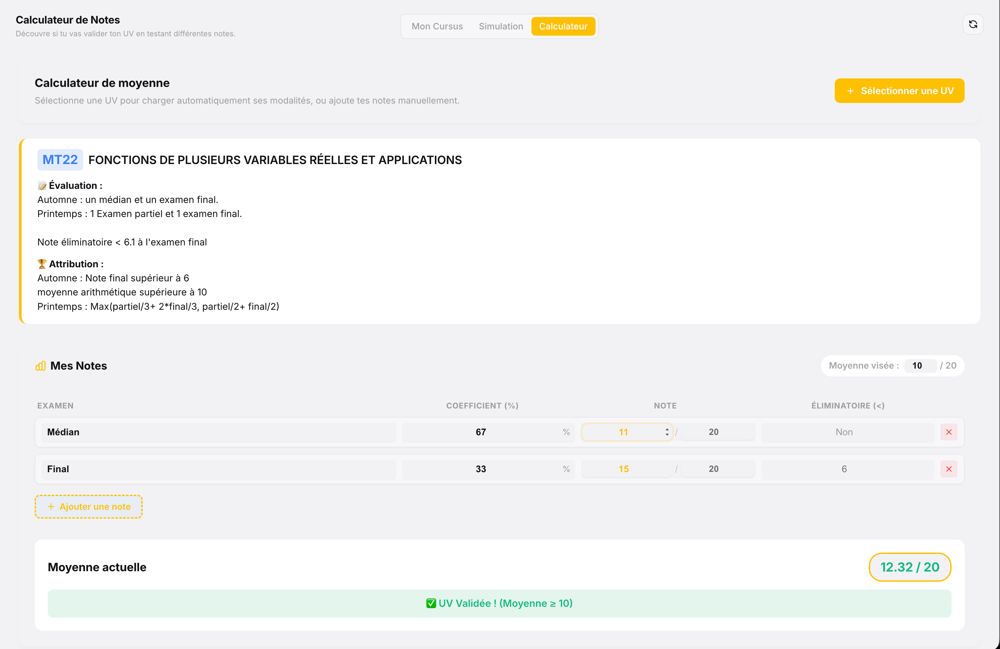

---

### 🔍 5. Le Hub UV : Tout réuni pour chaque matière
Cliquez sur n'importe quelle UV pour ouvrir son **Hub Dédié** regroupant l'ensemble des informations et outils associés :

| Vue | Description | Aperçu |
| :--- | :--- | :---: |
| **ℹ️ Infos & Syllabus** | Descriptif complet de l'UV, responsables pédagogiques, compétences visées, créneaux et crédits ECTS. | 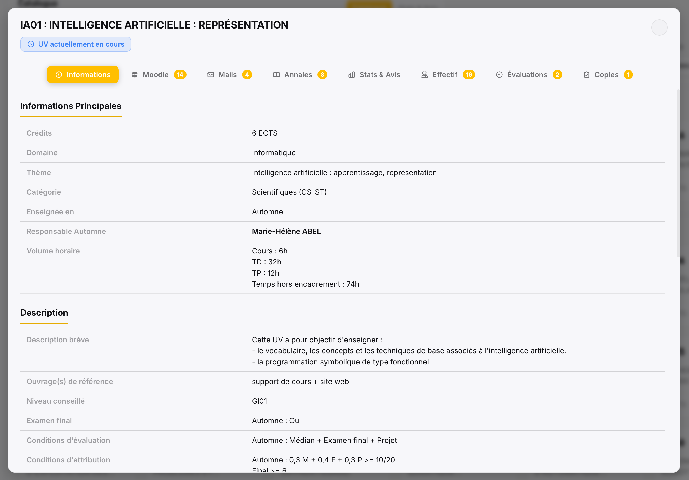 |
| **📚 Moodle Direct** | Accédez directement aux documents, TDs, TPs et annonces Moodle sans quitter votre session. | 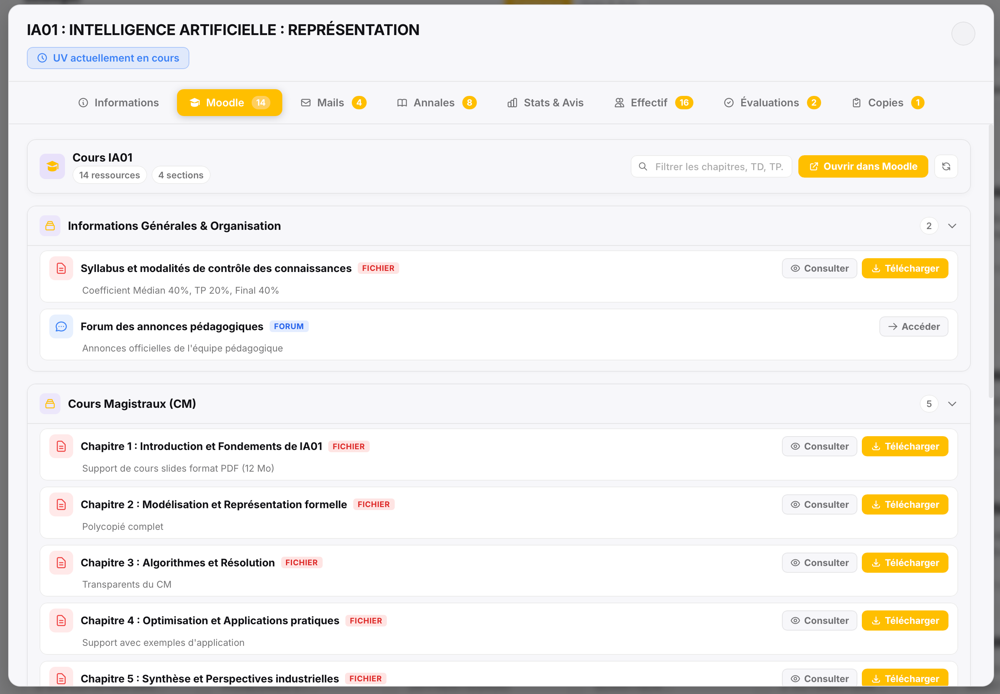 |
| **✉️ Mails de l'UV** | Filtre instantané sur votre messagerie UTC pour retrouver tous les mails liés à l'UV. | 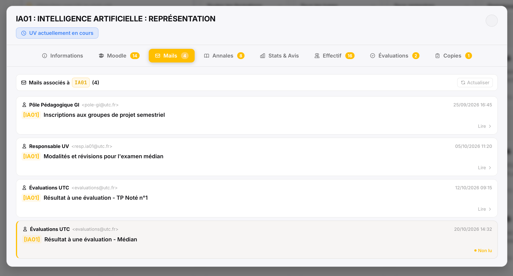 |
| **🦉 Annales (Shwet)** | Accès direct aux sujets d'examens précédents et corrigés d'entraide étudiante. | 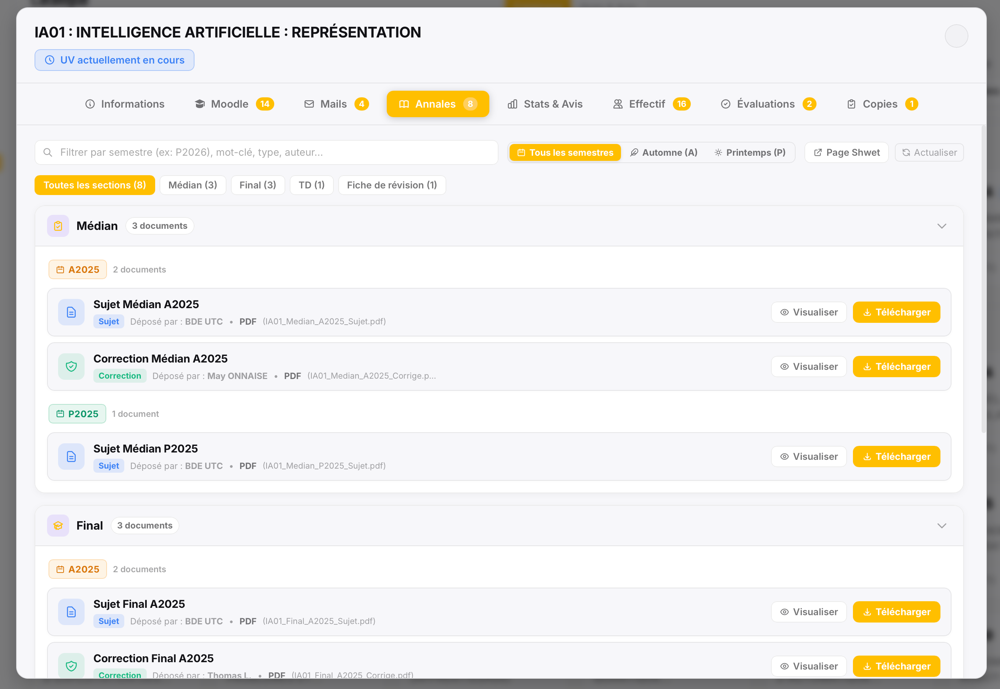 |
| **📊 Statistiques de Réussite** | Taux d'admission, répartition des notes des semestres précédents et historique. |  |
| **💬 Avis Étudiants** | Retours d'expérience, niveau de difficulté ressenti et conseils des anciens étudiants. | 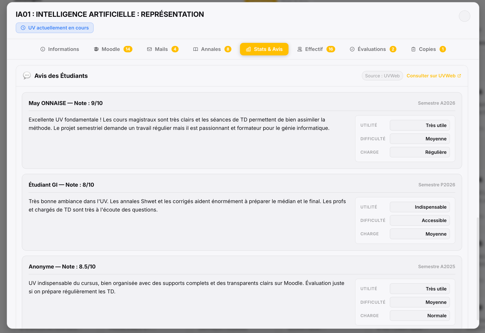 |
| **👥 Effectif & Groupes** | Liste des étudiants inscrits par groupe de TD/TP pour faciliter les travaux d'équipe. | 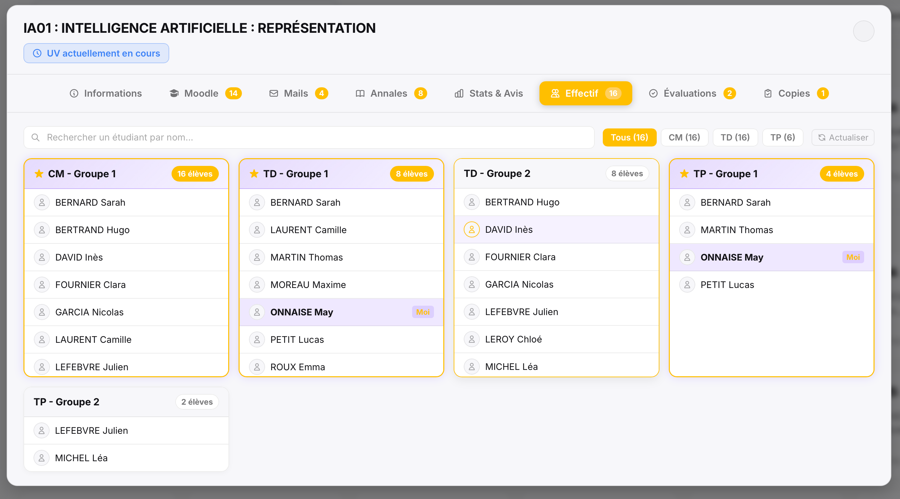 |
| **👤 Trombinoscope** | Vue visuelle des étudiants de l'UV pour identifier facilement vos camarades de promo. | 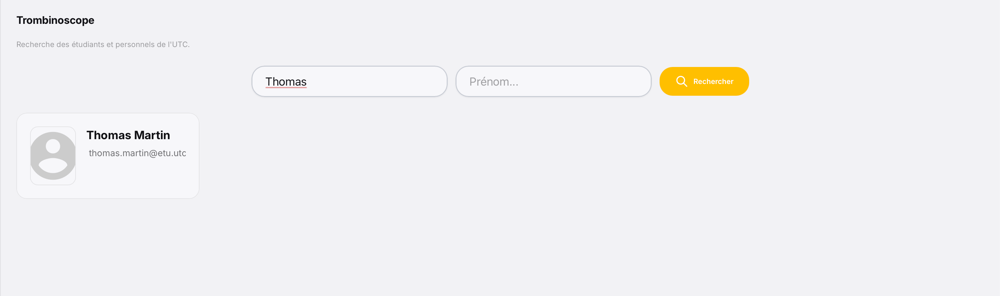 |
| **📝 Évaluations & Barèmes** | Coefficients des épreuves, dates prévues et suivi des notes publiées. | 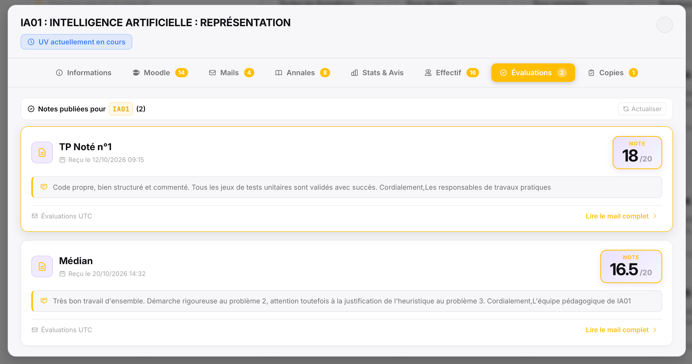 |
| **📄 Copies Corrigées (Wexam)** | Consultation et téléchargement direct de vos copies d'examens numérisées. | 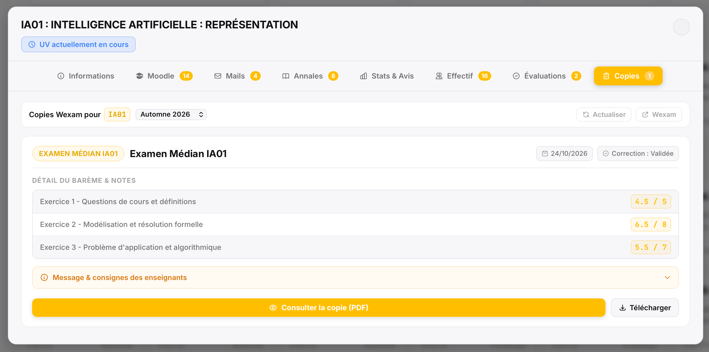 |

---

### 📖 6. Catalogue UV & Recherche Avancée
- Recherche instantanée par code UV, intitulé ou mots-clés.
- Filtres par catégorie : **CS**, **TM**, **TSH**, filières et semestres (Automne / Printemps).
- Fiches de présentation synthétiques avec accès aux avis étudiants.

  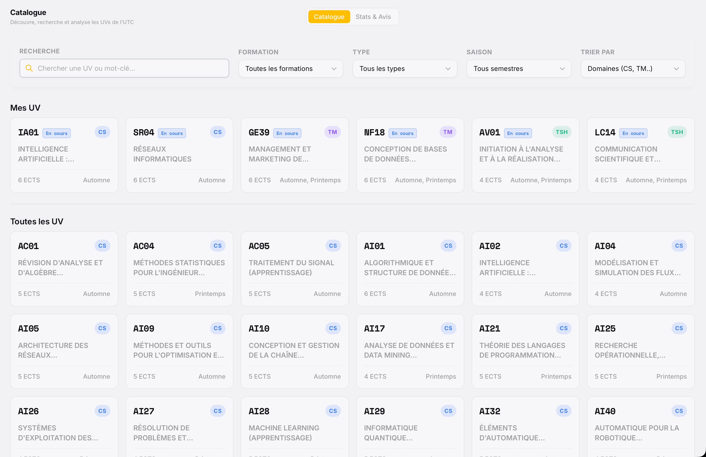

---

### 💳 7. PayUTC Intégré
- Consultation de votre solde en temps réel.
- Historique complet de vos dernières transactions au Pic'Asso, restos et cafétérias.
- Accès rapide aux fonctions de rechargement et transferts d'argent entre étudiants.

  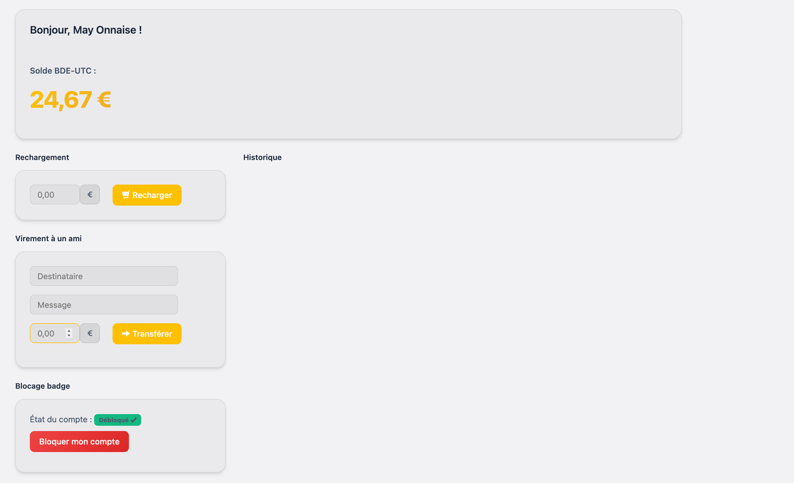

---

### ⚡ 8. Tous vos outils UTC centralisés
Accédez d'un simple geste aux services essentiels du quotidien universitaire :
- 🎓 **Moodle UTC** (Pédagogie & Cours)
- 💳 **PayUTC** (Paiements étudiants)
- 🦉 **Shwet** (Plateforme de partage & annales)
- 📝 **Wexam** (Copies & examens dématérialisés)
- 📧 **Webmail UTC** (Messagerie étudiante)
- 📒 **Notebook UTC** (Prise de notes & ressources)

---

## 🔒 Confidentialité & Sécurité : 100% Local

La protection de votre vie privée est le principe fondamental d'Edoko :
- 🛡️ **Aucun serveur intermédiaire** : Vos identifiants, notes, courriels et emplois du temps ne transitent par **aucun serveur tiers**.
- 🔑 **Authentification Officielle** : L'authentification s'effectue directement avec le portail officiel **CAS de l'UTC**.
- 💾 **Stockage Local** : Vos données sont conservées exclusivement dans le stockage local sécurisé de votre navigateur.
- ⚡ **Cache Intelligent & Hors-ligne** : Vous pouvez consulter votre emploi du temps et vos informations même sans connexion internet active.

---

## 🛠️ Stack Technique

- **Moteur** : Pur JavaScript moderne (Vanilla JS), conçu pour être ultra-léger et démarrer instantanément.
- **Architecture** : Standard **WebExtensions Manifest V3**, compatible avec les navigateurs Chromium et Firefox.
- **Design System** : Bento Grid UI, Glassmorphism, animations fluides et thèmes dynamiques (Light / Dark).

---

## 🚀 Téléchargement & Liens

| Plateforme / Ressource | Statut | Lien |
| :--- | :---: | :--- |
| **🌐 Site Web & Démo** | ✨ En ligne | [Visiter edoko-utc.vercel.app](https://edoko-utc.vercel.app) |
| **Mozilla Firefox** | ✅ Disponible | [Installer sur Firefox Add-ons](https://addons.mozilla.org/fr/firefox/addon/edoko/) |
| **Google Chrome** | ⏳ Bientôt | *Validation Chrome Web Store en cours* |
| **Microsoft Edge** | ⏳ Bientôt | *Validation Edge Add-ons en cours* |

---

  
Fait avec passion pour la communauté étudiante de l'<b>Université de Technologie de Compiègne (UTC)</b>.

